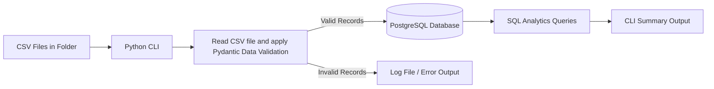

# Expense CSV Ingestion & Analytics Pipeline

\validates every row with **Pydantic**, loads the valid rows into **PostgreSQL**, logs the invalid rows with the exact reason they failed, and prints a summary of spending analytics in the terminal. The whole stack runs with a single command 
```bash
docker compose up --build
```

---

## Table of Contents

1. [Architecture Overview](#architecture-overview)
2. [Git Workflow Explanation](#git-workflow-explanation)
3. [Setup and Execution Instructions](#setup-and-execution-instructions)
---

## Architecture Overview



### Components

| Component | Responsibility |
|---|---|
| **CLI app** ([main.py](src/main.py)) | Configures file logging from `LOG_FILE` / `LOG_LEVEL`, then calls the [ingestor](src/ingestor/csv_ingestor.py) and the [analytics](src/analytics/analytics.py) module in order. |
| **Model** ([ExpenseRecord](src/model/expense_model.py)) | Defines what a valid expense is: required non-empty name and category, amount `> 0`, payment method one of `Cash` / `UPI` / `Card`, date in `YYYY-MM-DD` or `DD/MM/YYYY`, optional description. Whitespace is stripped automatically. |
| **Ingestor** ([csv_ingestor](src/ingestor/csv_ingestor.py)) | Loops over every `*.csv` file in the [input folder](src/input_files/), validates row by row, put valid records in a list, and logs each failed record with detailed error. |
| **Database layer** ([database](src/database/database.py)) | Ingestor calls database function to clears the table before a load, then call `insert_data_to_db` function to insert in batches with `execute_values` (batches of 100), and holds all analytics SQL. |
| **PostgreSQL** ([docker-compose](docker-compose.yml)) | Docker compose file has an image of postgresql database, it will store data in `expenses` table. `init.sql` runs automatically the first time the container starts. |
| **Analytics** ([analytics](src/analytics/analytics.py)) | Runs aggregation queries and prints them as formatted tables. |
| **pgAdmin** ([docker-compose](docker-compose.yml)) | Created this container to access Postgresql database through web UI on `http://localhost:5050`. |

### Project Structure

```
eval_m0/
├── src/
│   ├── main.py                  # Starting point: sets up logging, runs ingestion, then analytics
│   ├── model/
│   │   └── expense_model.py     # ExpenseRecord – Pydantic model with validation rules
│   ├── ingestor/
│   │   └── csv_ingestor.py      # Reads each CSV in the given folder, validates rows, sends valid rows to the DB
│   ├── database/
│   │   └── database.py          # Connection, truncate, batch insert, analytics SQL queries
│   ├── analytics/
│   │   └── analytics.py         # Call the database.py to Runs the queries and prints them as tables (tabulate)
│   └── input_files/             # Sample CSV input (*.csv)
├── tests/
│   └── test_expense_model.py    # pytest unit tests for the validation rules
├── init.sql                     # Script to be passed to docker-compose to create table schema and indexes
├── Dockerfile                   # Python application image configuration
├── docker-compose.yml           # db, app, pgadmin configuration
├── pyproject.toml / uv.lock     # Dependencies managed with uv
└── .env                         # Local config
```

---

## Git Workflow Explanation

The project follows a **feature branch workflow**. `main` always holds working, reviewed code. Every piece of work was done on its own branch and merged back through a pull request.

### Process followed for each feature

```bash
# 1. Start from the latest main
git checkout main
git pull origin main

# 2. Create a feature branch on GitHub, then on local machine
git fetch
git switch feature/<name>

# 3. Commit small, focused changes
git add <files>
git commit -m "Short description of the change"

# 4. Push the branch to GitHub
git push -u origin feature/<name>

# 5. Open a pull request feature/<name> -> main on GitHub, review the diff, merge, then delete the feature branch

# 6. Update local main after the merge
git checkout main
git pull origin main
```

---

## Setup and Execution Instructions

### 1. Clone the repository

```bash
git clone https://github.com/gillharleen/eval_m0.git
cd eval_m0
```

### 2. Create the `.env` file

`.env` is not committed. Create it in the project root:

```env
# PostgreSQL
POSTGRES_USER=db_user
POSTGRES_PASSWORD=db_password
POSTGRES_DB=expenses_db
POSTGRES_HOST=localhost      # overridden to "db" inside Docker Compose
POSTGRES_PORT=5432           # port the app connects to
POSTGRES_INT_PORT=5432       # port Postgres listens on inside the container

# pgAdmin
PGADMIN_EMAIL=admin@example.com
PGADMIN_PASSWORD=pg_admin_password

# Logging
LOG_FILE=m0_expense_ingest.log
LOG_LEVEL=INFO
```

### Option A — Entire system runnable using one command

```bash
docker compose up --build
```

This will:
1. start PostgreSQL database and run `init.sql` on first start,
2. wait until the database is healthy,
3. build the app image and run `python src/main.py`,
4. start pgAdmin on <http://localhost:5050>.

The analytics tables appear in the terminal, prefixed with `app-1  |`. The `app` container exits after printing; `db` and `pgadmin` keep running. 

```bash
docker compose down        # stop containers
```

### Option B — Run the Python app locally (but database in Docker)

```bash
# Start only PostgreSQL and PgAdmin Containers
docker compose up -d db pgadmin

# Install dependencies and run the pipeline
uv sync
uv run src/main.py
```

### Run the tests

```bash
uv run pytest -v
```

```
tests/test_expense_model.py::test_valid_row PASSED                       [ 20%]
tests/test_expense_model.py::test_day_first_date PASSED                  [ 40%]
tests/test_expense_model.py::test_negative_amount_is_rejected PASSED     [ 60%]
tests/test_expense_model.py::test_empty_category_is_rejected PASSED      [ 80%]
tests/test_expense_model.py::test_wrong_payment_method_is_rejected PASSED [100%]

============================== 5 passed in 0.11s ===============================
```

[test_expense_model.py](tests/test_expense_model.py)

### Clean-slate verification

```bash
docker compose down
docker compose up --build
```

`down` removes the container, so `init.sql` runs again and the whole pipeline is tested from zero.